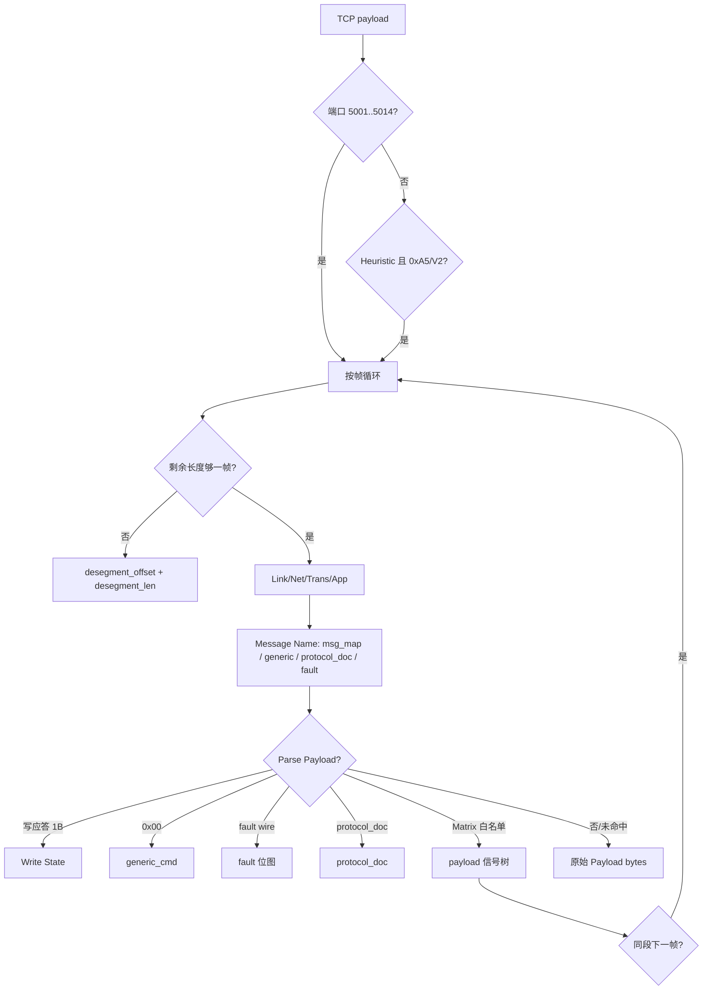

---
tags:
  - wireshark
  - BMS
  - 底软协议
created: 2026-06-06
updated: 2026-10-15
status: implemented
---

# BMS2.0 底软协议 Wireshark V2 解析方案

## 0. 结论

**Lua dissector**（`output/bms20_v2.lua`），无需编译；**Reload Lua Plugins** 即生效。

- **TCP 端口**：固定注册 **5001**（HMI）、**5002**（BBMS）、**5003..5014**（RBMS 各簇）；对端端口不固定；源或目的命中即可。
- **帧格式**：V2（`0xA5` + version:5/len:11 小端位域 + CRC16-Modbus + 网络/传输/应用头 + payload）。
- **LAN Matrix 双版本**：`output/matrix_v1_0_50/`、`output/matrix_v1_0_57/`；默认 **V1.0.57**；Pref **LAN Matrix version** 切换后须 Reload。
- **深度解析**：Comm Matrix Payload（树文本信号）、故障位图、通用命令（0x00）、协议文档补遗报文；白名单见各版本 `bms20_parse_config.lua`（**不按端口拦截**）。
- **TCP 重组**：多 PDU / 跨段报文依赖 `pinfo.desegment_offset` + `desegment_len`；需开启 TCP *Allow subdissector to reassemble TCP streams*。

使用者安装与过滤器见 [[BMS2.0-Wireshark插件使用说明]]。

## 1. 交付物布局

```text
3.wireshark_plugin/
├── output/                         ← 复制到 Wireshark Personal Lua Plugins
│   ├── bms20_v2.lua                ← 主 Proto / 端口注册 / Pref / 多帧+desegment
│   ├── bms20_matrix.lua            ← 按 Pref 加载 matrix_v1_0_* 包
│   ├── bms20_matrix_registry.lua   ← 版本列表（生成）
│   ├── bms20_payload.lua           ← Comm Matrix 运行时（tvbrange 标签展开）
│   ├── bms20_fault.lua / bms20_fault_defs.lua
│   ├── bms20_generic_cmd.lua       ← cmdGroup 0x00（手维护）
│   ├── bms20_protocol_doc.lua      ← Matrix 未收录报文（生成）
│   ├── matrix_v1_0_50/             ← V1.0.50 包
│   └── matrix_v1_0_57/             ← V1.0.57 包（默认）
│       ├── bms20_msg_map.lua
│       ├── bms20_parse_config.lua
│       ├── bms20_payload_manifest.lua
│       └── bms20_payload_*.lua
├── tools/                          ← 生成器（matrix_registry / regenerate_plugins …）
└── docs/
```

| 模块 | 职责 |
| :--- | :--- |
| `bms20_v2.lua` | 链路解析、CRC、Message Name、调度 payload/fault/generic/protocol_doc；字段表在端口注册前一次性 `proto.fields` |
| `bms20_matrix.lua` | `dofile` 加载对应版本 msg_map / parse_config / payload；失败写控制台与 `bms20_matrix_last_error` |
| `bms20_payload.lua` | 按 `start_bit`/`bit_len`/`array_count` 展开；信号用 `tree:add(tvbrange, label)`（避免逐信号 ProtoField 晚注册） |
| `gen_payload_defs.py` | 从 xlsx 生成字段表；`reconcile_start_bit` 校正 Excel Start Bit 与 byte_hint 冲突 |

## 2. 帧格式要点

```text
a5 xx xx crc_lo crc_hi | src srcSub dest destSub | tt frameId | cmdG cmdI | data…
└─ Link 5B ────────────┘ └─ Network 4B ──────────┘ └Trans 2B─┘ └App 2B──┘
```

```lua
local ver_len = tvb(1, 2):le_uint()
local version = bit.band(ver_len, 0x1F)   -- 须为 2
local datalen = bit.rshift(ver_len, 5)  -- body 长度（含 8B 头）
-- 整帧 = 5 + datalen；payload = datalen - 8
```

CRC16-Modbus 覆盖 byte6..n（小端存放于 byte4..5）。

## 3. 解析流水线



**解析优先级（Application Layer）：** write-ack → generic(0x00) → protocol_doc → fault → Matrix payload（含 `BBMS_CtlWordAllRack` 重复元素）→ raw。

## 4. Matrix 与 Payload 约定

| 项 | 约定 |
| :--- | :--- |
| 字节序 / 位序 | Intel 小端 / LSB first（与 Comm Matrix 一致） |
| 数组 | `array_count > 1` 时父节点高亮 `array_count × bit_len` 对应字节范围 |
| Start Bit 冲突 | 生成器对字节对齐、hint 为范围的字段，优先 `byte_hint` 起址（如 V1.0.57 `Reserved5`） |
| 显示 | 信号行文本 `Name: raw — desc`；可选 phys（res/offset）；**无** `bms20.payload.*` 显示过滤器 |
| 白名单 | `bms20_payload_by_segment` 消息名 `true/false`；段 key 仅分组 |

## 5. 安装与验收

见 [[BMS2.0-Wireshark插件使用说明]] §3–§4。要点：

- 复制 **`output/` 整夹**（勿只拷根目录 `*.lua`）
- Pref：**LAN Matrix version**、**Parse Payload**
- TCP：**Allow subdissector to reassemble TCP streams**

### 验收清单

- [x] V2 帧头 / CRC / 多帧拆分
- [x] 5001..5014 服务端口标注与 `rack_id`
- [x] 双版本 Matrix 包切换（50 / 57）
- [x] Comm Matrix Payload 展开（含数组高亮字节范围）
- [x] 故障位图 Active Faults
- [x] 通用命令 + 协议文档补遗
- [x] 跨 TCP 段 PDU desegment（offset+len）

## 6. 维护

```bash
uv run python 3.wireshark_plugin/tools/regenerate_plugins.py
```

版本登记：`tools/matrix_registry.py`（`SUPPORTED_MATRIX_VERSIONS` / `DEFAULT_MATRIX_VERSION`）。xlsx / xlsm 输入在 `docs/references/`。

## 7. 协议依据

- [[BMS2.0底软通信协议.pdf]] — V2 帧
- [[通用命令协议文档.pdf]] — cmdGroup 0x00
- [[BMS2.0 LAN Matrix V1.0.57.xlsx]] / V1.0.50 — Message ID / Comm Matrix
- `SystemConfiguration_*.xlsm` — FaultList
- [[BMS2.0 协议文档.pdf]] — Matrix 未收录报文

## 8. 明确不做 / 已放弃的方案

| 方案 | 原因 |
| :--- | :--- |
| 逐信号 ProtoField | 端口绑定后晚注册导致 `tree:add` bad self；现用 tvbrange 标签 |
| 根目录扁平 `bms20_payload_*.lua` | 已迁入 `matrix_v1_0_*` 包，生成器会清理遗留扁平文件 |
| 按 TCP 端口过滤 Payload 白名单 | 与 HMI 转发等场景冲突；现仅按消息名 |
